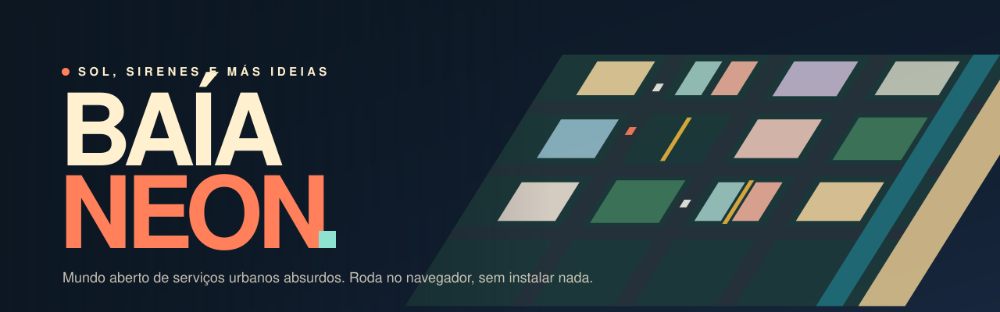
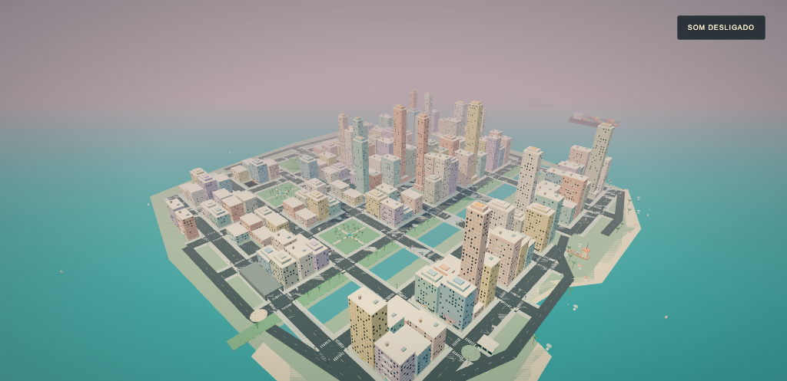
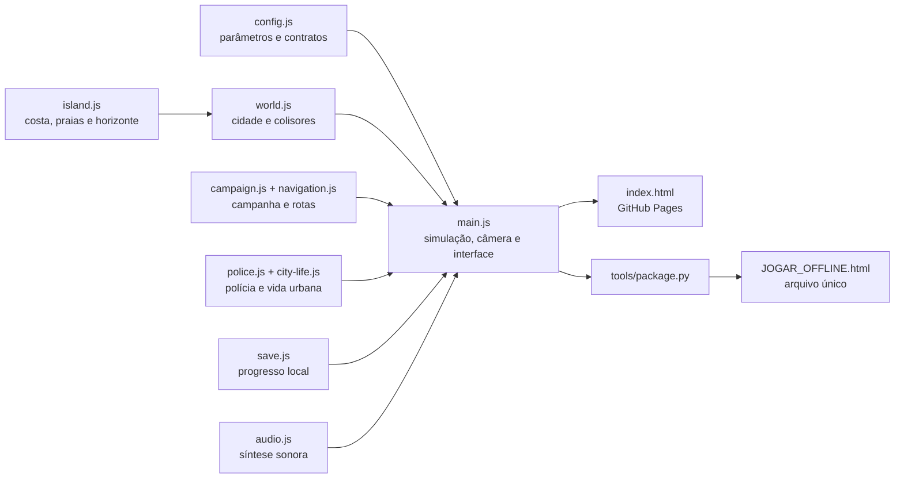

<p align="center">
  <a href="https://iosbilario.github.io/baia-neon/"></a>
</p>

<p align="center">
  <a href="https://iosbilario.github.io/baia-neon/"></a>
  <a href="https://github.com/iosbilario/baia-neon/releases/latest"></a>
</p>

<p align="center">
  <a href="LICENSE"></a>
  <a href="https://github.com/iosbilario/baia-neon/actions/workflows/ci.yml"></a>
  <a href="https://github.com/iosbilario/baia-neon/releases/latest"></a>
  <a href="https://github.com/iosbilario/baia-neon/commits/main"></a>
  <a href="https://github.com/iosbilario/baia-neon/stargazers"></a>
</p>

<p align="center">
  <a href="https://iosbilario.github.io/baia-neon/"><b>Jogar agora</b></a> ·
  <a href="#como-se-joga">Como se joga</a> ·
  <a href="#controles">Controles</a> ·
  <a href="#a-cidade">A cidade</a> ·
  <a href="#polícia">Polícia</a> ·
  <a href="#por-dentro">Por dentro</a> ·
  <a href="https://github.com/iosbilario/baia-neon/releases/latest">Versão offline</a>
</p>

Baía Neon é um jogo 3D de mundo aberto que roda direto no navegador. Você
ajuda a Rádio Caju a fazer sua última transmissão em uma campanha curta,
dirige por uma ilha inventada, aceita serviços, disputa contrarrelógios e
foge da polícia quando o atalho dá errado. Sem instalação, cadastro, anúncios
ou telemetria.

**Jogue em [iosbilario.github.io/baia-neon](https://iosbilario.github.io/baia-neon/).**
Funciona no computador com teclado e mouse, com controle (gamepad) e no celular em modo paisagem. O
navegador precisa oferecer WebGL.

<p align="center">
  <a href="https://iosbilario.github.io/baia-neon/"></a>
</p>
<p align="center"><sub>Ilha Ferradura (captura da v0.6.1). A imagem vem do jogo real.</sub></p>

## Como se joga

Dirigir bem, conhecer a cidade e improvisar uma fuga rendem dinheiro. O
dinheiro muda a próxima partida.

- **Jogue Última Frequência.** Cinco missões encadeadas levam Dora Dendê e Nando Hertz pela mudança da Rádio Caju.
- **Escolha um serviço.** O quadro oferece entregas, passageiros e recuperação de veículos conforme sua reputação.
- **Conheça as ruas.** `M` abre o mapa, permite marcar um ponto e traça uma rota pelas ruas e pontes.
- **Dispute tempo.** `L` inicia um de três percursos com medalhas e recorde local por veículo.
- **Gaste na oficina.** Reparo, melhorias com contrapartida, munição e outros carros. O progresso fica salvo no navegador.
- **Fuja com a cabeça.** A polícia procura o carro em que você foi visto. Trocar de veículo, entrar numa viela ou atravessar um parque a pé são saídas diferentes.

### Contratos

| Contrato | Regra da carga | Pagamento |
| --- | --- | --- |
| Sorvete em risco | Derrete com o tempo | Até R$ 260, 30% garantido |
| Reunião dos flamingos | Perde integridade a cada batida | Até R$ 300, 25% garantido |
| Café depois das seis | Derrapagem e freada brusca derramam o bônus | Até R$ 240, 60% garantido |

Chuva paga 20% a mais. Se a carga chega a zero ou o carro é destruído, o
contrato acaba sem pagamento.

### Veículos

| Modelo | Ponto forte | Limitação |
| --- | --- | --- |
| Maré Compacto | Curva rápido e cabe nas vielas | Amassa fácil |
| Sedã Atlântico | Estável, freia bem, aguenta pancada | Lento para virar |
| Esportivo Brisa 78 | Retomada e velocidade final | Traseira solta, pior na chuva |

O carro tem velocidade lateral: ele derrapa, e o freio de mão solta a
traseira. Batidas e tiros amassam, tiram velocidade, soltam fumaça, pegam
fogo e terminam em explosão.

### Oficina

Fica no marcador laranja do mapa e abre com `Enter`.

| Item | Efeito | Preço |
| --- | --- | --- |
| Reparo | Zera o dano do carro | R$ 40 a 80 |
| Freios reforçados | Para 60% mais forte | R$ 300 |
| Pneus de chuva | Quase sem perda no molhado, 6% menos velocidade final | R$ 300 |
| Proteção de carga | Carga perde 40% menos, 8% menos aceleração | R$ 300 |
| Munição e granadas | 24 balas ou 2 granadas | R$ 60 e R$ 90 |
| Sedã e Esportivo | Trocam o seu carro | R$ 900 e R$ 1.600 |
| Repintar | Durante a fuga, a polícia segue procurando o carro antigo | R$ 150 |

## Controles

| Entrada | Ação |
| --- | --- |
| `W` `A` `S` `D` | Caminhar ou dirigir |
| `Shift` | Correr |
| `E` | Entrar, sair, conversar ou interagir |
| `Espaço` | Freio de mão |
| `1` `2` `3` | Aceitar uma oferta do quadro |
| `Enter` | Ação contextual ou oficina |
| `M` | Abrir mapa, marcar destino e acompanhar a rota |
| `L` | Iniciar o próximo percurso contra o relógio |
| `P` | Abrir o modo foto |
| `Y` | Repetir uma missão após falhar |
| `X` | Escolher a retirada arriscada na missão do carro |
| Movimento do mouse | Girar a câmera com o ponteiro preso ao jogo |
| Segurar botão direito | Mirar sobre o ombro |
| Clique esquerdo ou `F` | Atirar pela mira central; no carro, `F` buzina |
| `Q`, roda do mouse, `4` `5` `6` | Trocar de arma: pistola, submetralhadora, espingarda |
| `R` | Recarregar a arma atual |
| `G` | Arremessar granada |
| `H` | Consultar controles |
| `Esc` | Pausar ou pular a abertura |

`Esc` também libera o ponteiro. Em celulares, use o aparelho na horizontal: analógico esquerdo para movimento ou direção, deslize do lado direito para olhar e use os botões contextuais de ação, corrida, mira, aceleração, freio e freio de mão.

**Controle (gamepad).** Analógico esquerdo move ou dirige, direito olha, `RT` acelera ou atira, `LT` freia, `A` interage ou confirma, `B` volta ou usa o freio de mão, `X` atira de dentro do carro, `Y` recarrega, `LB` e `RB` trocam de arma, o direcional navega nos menus, `SELECT` abre o mapa e `START` pausa. Os prompts da tela mudam conforme o último dispositivo usado.

**Interiores.** Entre a pé pelas portas da Rádio Caju, da Oficina do Canal, do Mercado Maré Alta e do Píer Farol. **Ruas de sentido único** têm setas no asfalto e o GPS respeita a mão.

`T` alterna a chuva e `N` alterna dia e noite, para experimentar.

## A cidade

Uma ilha litorânea fictícia com cerca de 600 por 600 metros, costa irregular
e geração determinística.

- **Centro Solar.** Núcleo vertical protegido no interior, com arranha-céus,
  trânsito e vielas exclusivas para o compacto.
- **Avenida da Orla.** Acompanha a maior parte da costa e recebe as ruas
  principais antes que elas alcancem o mar.
- **Canal das Garças.** Sete pontes e ligação com a baía interna.
- **Praia Aurora.** Avenida panorâmica, hotéis, marina e acesso ao Píer Farol.
- **Parques.** Quatro áreas para pedestres, incluindo um parque elevado.
- **Horizonte.** Ilha distante, farol, navio cargueiro, boias e tempestade
  continuam além do limite jogável como cenário sem colisão.

A cidade tem pedestres com rotina, ciclistas sentados e pedalando, trabalhadores,
atividades nos parques, trânsito, cães, gaivotas, borboletas e vagalumes. Ciclistas
e visitantes dos parques respondem à ação contextual e reagem a colisões. O dia
dura 12 minutos, as janelas acendem à noite e a chuva chega de vez em quando.

## Polícia

O sistema de procurado segue a lógica de estrelas dos jogos de mundo aberto,
com regras que dá para entender e explorar.

| Regra | Como funciona |
| --- | --- |
| Denúncia | A polícia só vem se um policial vir o crime ou uma testemunha terminar a ligação. Quem está ligando ganha um marcador amarelo |
| Estrelas | Sobem pela gravidade acumulada. Um furto dá uma estrela, e cada estrela seguinte exige bem mais violência |
| Resposta | Uma viatura por estrela, com reforços chegando um a um. A partir de duas estrelas, a segunda tenta interceptar adiante |
| Abordagem | Os policiais descem da viatura para prender. Só atiram a partir de duas estrelas e se houve violência |
| Identificação | Eles procuram o veículo em que você foi visto. Trocar, descer ou repintar sem ser visto encurta a busca |
| Busca | Fora de vista as estrelas piscam, e cada unidade só enxerga um cone à frente, desenhado no minimapa |
| Fuga | 16 segundos fora de vista e longe da última posição com uma estrela, mais 5 por estrela extra |

Morrer mostra a tela em câmera lenta e custa R$ 150. Ser preso custa R$ 100,
as granadas e a munição reserva.

## Por dentro

HTML, CSS e JavaScript clássico com uma cópia local do Three.js r160. Não há
etapa de compilação, dependência de pacote, servidor, conta ou telemetria. A
política de segurança da página bloqueia qualquer conexão do jogo.



| Caminho | Conteúdo |
| --- | --- |
| `index.html`, `styles.css` | Interface, menu e HUD |
| `src/` | Código do jogo, campanha, save, navegação e metadados de build |
| `vendor/` | Three.js r160, versão fixa |
| `assets/` | Texturas, modelos, sons, capturas e catálogo de procedência |
| `tests/` | Cenários policiais, integração, campanha, migração e empacotamento |
| `tools/` | Empacotador offline, gerador reproduzível de releases e auditorias |
| `.github/workflows/` | Validação, publicação e recuperação do GitHub Pages |

### Rodar e testar

Abra `index.html` no navegador ou sirva a pasta com qualquer servidor
estático. Os testes usam só o Node, sem instalar pacotes.

```sh
node tests/police.test.js
node tests/integration.test.js
node tests/v03.test.js
python3 tools/audit_offline.py
python3 tests/release.test.py
```

### Publicação

Pull requests e `main` passam pelo workflow de validação. Releases são acionadas
manualmente com versão e SHA completo, geradas uma única vez e publicadas primeiro
como rascunho. O GitHub Pages recebe exatamente o ZIP web da release estável.
Consulte [docs/RELEASING.md](docs/RELEASING.md) para publicação e recuperação.

### Jogar sem internet

O site precisa de conexão para carregar. Para jogar offline, abra a
[página da release mais recente](https://github.com/iosbilario/baia-neon/releases/latest),
baixe o HTML ou ZIP offline e abra o arquivo no navegador. O ZIP offline também inclui instruções, licenças,
metadados de versão e hashes.

## Limites atuais

Este é um protótipo compacto, com colisões por volumes e direção arcade.

- Não há interiores, bloqueios de rua, ruas de sentido único, troca de armas,
  tiro de dentro do carro, capotamento, multiplayer ou suporte a controle físico.
- Pedestres não bloqueiam a passagem. Postes e semáforos não têm colisão.
- O jogo reduz resolução e desliga sombras quando a média medida cai abaixo de 28 FPS.
- A campanha foi desenhada para 20 a 30 minutos; o tempo varia com exploração,
  rotas, polícia e experiência de direção.
- O histórico das versões e correções fica no [CHANGELOG.md](CHANGELOG.md).

## Licença e autoria

O código próprio usa a [licença MIT](LICENSE). O Three.js acompanha seu
[aviso MIT](licenses/THREE-MIT.txt). Os recursos originais têm dedicação
[CC0 1.0](licenses/ASSETS-CC0.md), com a origem registrada em
[licenses/PROCEDENCIA.md](licenses/PROCEDENCIA.md).

A cidade, os nomes e os estabelecimentos são fictícios. O jogo não usa
personagens, mapas, marcas, músicas ou carros de outros jogos. O nome Baía
Neon é provisório e não passou por pesquisa de registro.

O projeto foi desenvolvido de forma iterativa a partir do pedido registrado em
[PROMPT_FABLE_5_2.md](PROMPT_FABLE_5_2.md).
