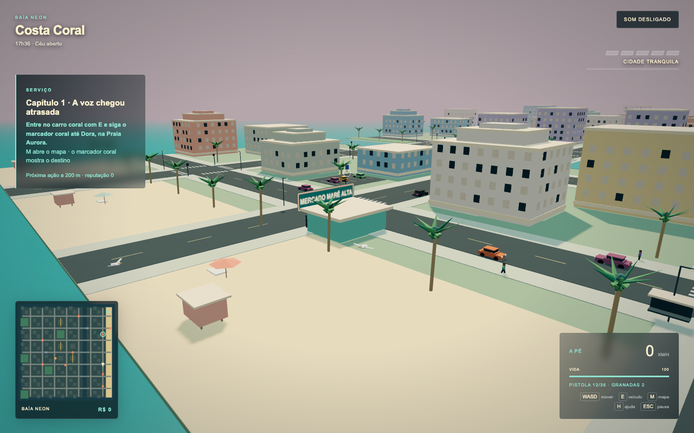
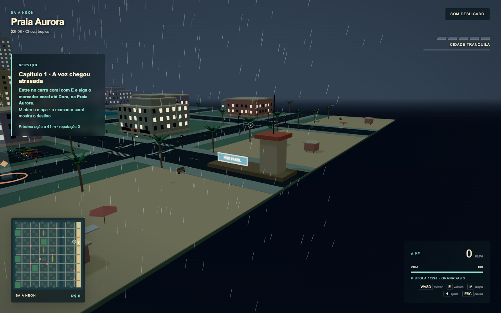

# Baía Neon v0.3.0-rc.1 — Última Frequência

Candidata da atualização que transforma o protótipo em uma campanha curta com progressão recuperável.

## Para quem joga

- Cinco missões encadeadas da Rádio Caju, dois personagens recorrentes, checkpoints, falha e repetição.
- Mapa em `M` com destino clicável e rota pelas ruas e pontes.
- Contratos de passageiros e recuperação, três contrarrelógios em `L`, reputação e recordes por veículo.
- Modo foto em `P`, exportação e importação do progresso na pausa.
- Novas fachadas, marcos, antena, mercado, oficina, píer, mobiliário, poças e iluminação.

## Saves

O save v0.2 é copiado e migrado para `baia-neon-save-v2`. O dado antigo não é apagado. Recompensas de campanha são registradas para impedir pagamento duplicado.

## Controles novos

`M` abre o mapa, `L` inicia um contrarrelógio, `P` abre o modo foto, `Y` repete uma missão falha e `X` escolhe a retirada arriscada do carro da rádio.

## Capturas reais

## Limitações conhecidas

Alvo exclusivo para computador com teclado e mouse. Sem interiores, controles de toque ou controle físico. Os resultados automatizados, capturas e testes manuais pendentes constam em `docs/VERIFICACAO_V03.md`.
