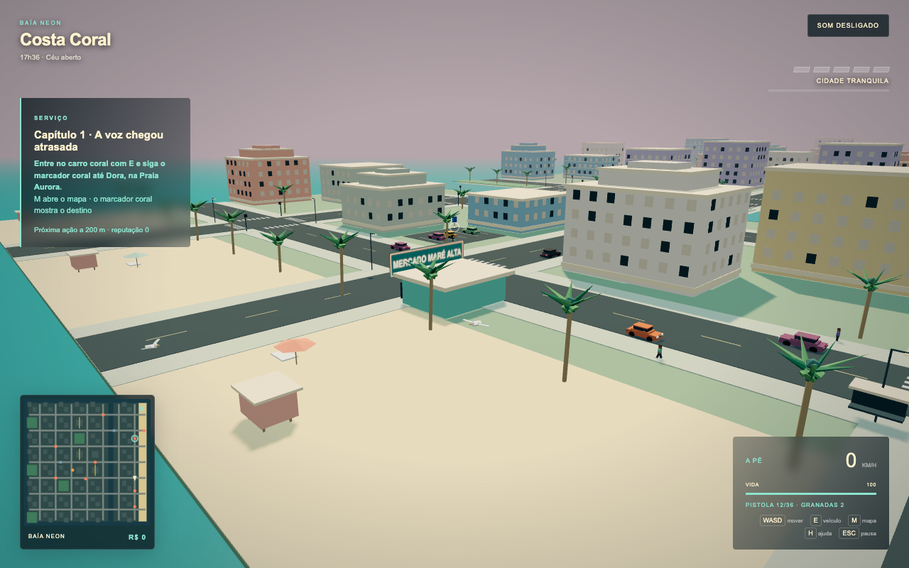
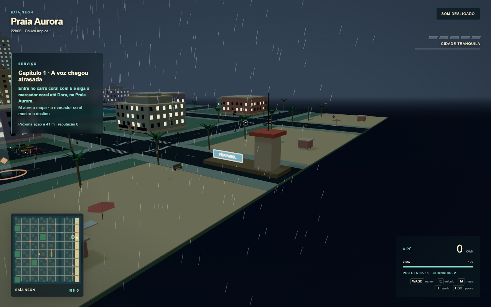

# Baía Neon v0.3.0 — Última Frequência

Release estável da campanha da Rádio Caju, promovida do mesmo SHA aprovado na candidata.

## Para quem joga

- Campanha completa de cinco missões, atividades repetíveis e desfecho visível no Píer Farol.
- Mapa ampliado com rota viária, contratos variados, três contrarrelógios, reputação e modo foto.
- Evolução visual dos bairros, fachadas, marcos urbanos, veículos, iluminação e chuva.
- Exportação, importação e migração segura do progresso.

## Controles novos

`M` abre o mapa, `L` inicia um contrarrelógio, `P` abre o modo foto, `Y` repete uma missão falha e `X` escolhe a retirada arriscada do carro da rádio.

## Saves

Saves v0.2 são preservados e migrados para o schema 2. O site e o HTML offline podem manter armazenamentos separados. Recompensas válidas são pagas uma única vez.

## Capturas reais

## Limitações conhecidas

Alvo para computador com teclado e mouse. Sem interiores, controles de toque, controle físico ou multiplayer. Consulte `docs/VERIFICACAO_V03.md` para o ambiente, os testes, o desempenho medido e eventuais pendências.
